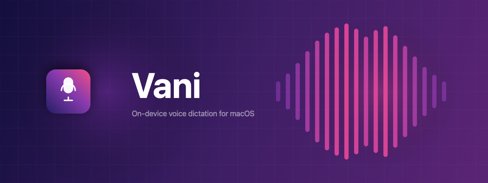

<p align="center">
  
</p>

<p align="center">
  
  
  
  
  
</p>

<p align="center">
  <strong>Hold Fn. Speak. Done.</strong><br/>
  On-device voice dictation for macOS — no servers, no API keys, no subscriptions.
</p>

<p align="center">
  <a href="https://github.com/Anuragh33/Vani/releases/latest">
    
  </a>
</p>

---

## How it works

Hold **Fn** anywhere on your Mac. Speak naturally. Release. Polished text appears instantly in whatever app is focused — Terminal, Chrome, Slack, Xcode, anywhere.

```
Hold Fn  →  mic records  →  SpeechAnalyzer transcribes  →  Foundation Models polishes  →  text injected
```

Every step runs entirely on your Mac using Apple's frameworks introduced in macOS 26.

---

## Features

| | |
|---|---|
| **On-device STT** | `SpeechAnalyzer` (macOS 26) — Whisper-class accuracy, no internet |
| **AI polish** | `FoundationModels` removes filler words, fixes grammar, matches tone |
| **Works everywhere** | Terminal, browsers, Electron apps, Slack — anything that accepts ⌘V |
| **Context-aware** | Auto-detects Mail, Slack, Xcode and adjusts polish style |
| **Custom vocabulary** | Bias recognition toward names, jargon, acronyms you use |
| **Multilingual** | Any locale supported by Apple's speech models |
| **Minimal overlay** | Tiny waveform pill with target app icon while recording |
| **iCloud sync** | Hotkey, context, vocabulary roam across your Macs |
| **Menu bar only** | No Dock icon, lives quietly in your menu bar |

---

## Requirements

- macOS 26 (Tahoe) or later
- Apple Silicon (M-series chip)

---

## Install

1. **[Download Vani-0.1.2.dmg](https://github.com/Anuragh33/Vani/releases/latest)**
2. Open the DMG, drag **Vani** into **Applications**
3. Double-click **Install Vani.command** inside the DMG and click **Open**
4. Grant Microphone, Speech Recognition, and Accessibility permissions when prompted
5. Hold **Fn** to dictate

> The install script removes a Gatekeeper flag that blocks unsigned apps downloaded from the internet. It runs one command: `xattr -dr com.apple.quarantine /Applications/Vani.app`

---

## Build from source

```sh
brew install xcodegen
git clone https://github.com/Anuragh33/Vani.git
cd Vani
xcodegen generate
open Vani.xcodeproj
```

Set your signing Team in Xcode → ⌘R.

---

## Tech stack

| Layer | Technology |
|---|---|
| Language | Swift 6 |
| UI | SwiftUI + AppKit |
| Speech-to-text | `Speech` — `SpeechAnalyzer` + `SpeechTranscriber` |
| AI text polish | `FoundationModels` — `SystemLanguageModel` |
| Text injection | Accessibility API + clipboard + ⌘V fallback |
| Hotkey | `CGEventTap` via CoreGraphics |
| Audio | `AVAudioEngine` + Accelerate FFT |

---

## Privacy

- No data ever leaves your Mac
- No analytics, no tracking, no accounts
- Dictation history lives in memory only and clears on quit

---

<p align="center">Made by <a href="https://github.com/Anuragh33">Anurag</a></p>
